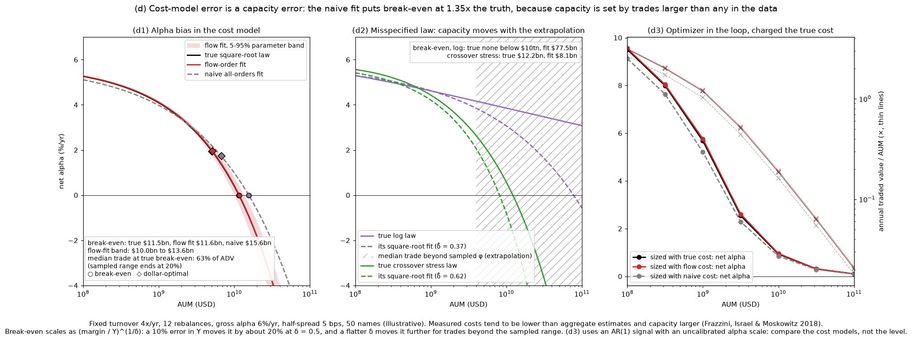
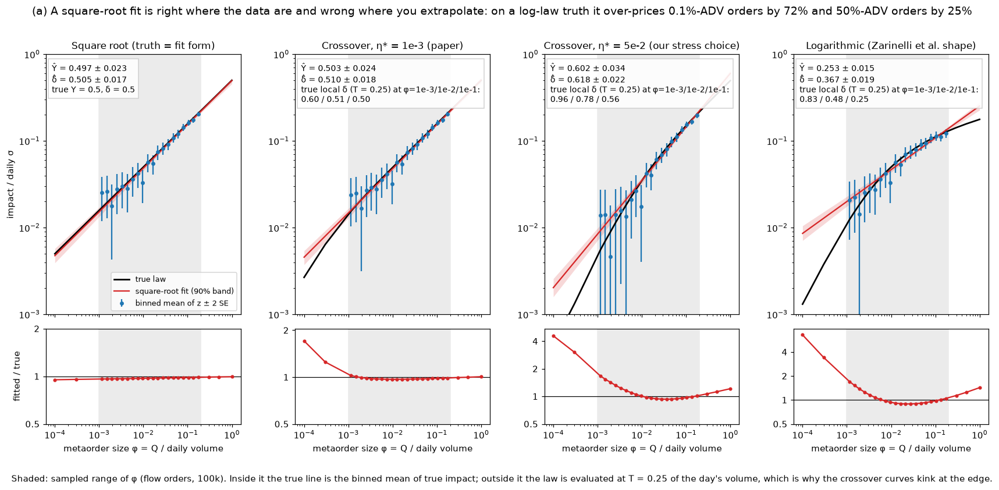
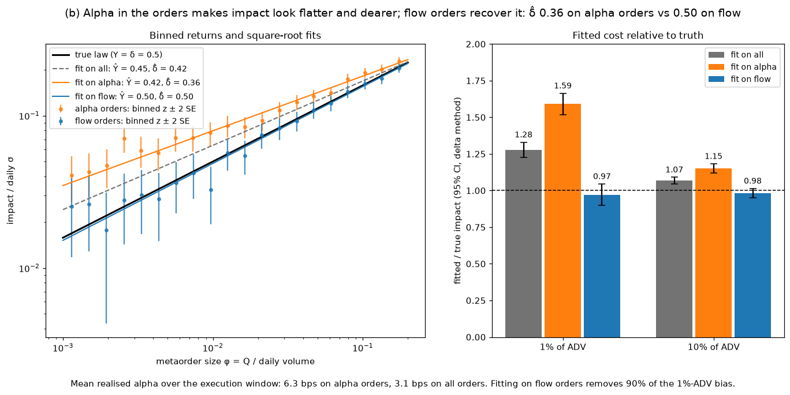
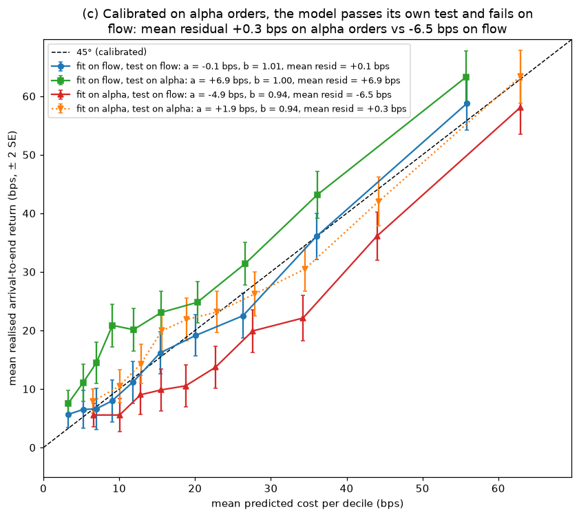

# impact-lab

**How wrong is your impact model, in which direction, and what does that do to how big your
strategy can get?**

impact-lab calibrates a metaorder market-impact model on synthetic data where the true impact
law, the true alpha and the flow/informed label of every order are known, and carries the
calibration error into a capacity curve and a cost-penalised optimizer. Recovering a square-root
law from square-root data is the calibration check, not the result. The results are what a
square-root fit does when the truth is a different law, when the orders carry alpha, and how far
each error moves capacity.

All data are simulated; model forms and parameters come from the cited published papers, and
nothing here is proprietary to any employer. Builds on
[tca-groundtruth](https://github.com/zhuanyi/tca-groundtruth), whose order generator and
intraday profile it reuses.

## Headline chart



Panel (d1): net alpha against AUM at fixed turnover. The flow-order fit (red, with its 5-95%
parameter band) tracks the true square-root law; the naive fit on all orders (grey) puts
break-even at $15.6bn against a true $11.5bn. Capacity is decided by trades of about 63% of daily
volume, three times larger than any order in the calibration sample, so the capacity number is an
extrapolation of the cost model, whichever fit is used.

## Three findings (seed `20261028`, `make report`, numbers from `reports/summary.csv`)

| | Finding | Numbers |
|---|---|---|
| (b), (d1) | **Alpha in the orders makes impact look flatter and dearer for small orders, and cheaper for the large trades that set capacity.** Informed orders realise part of their alpha during execution, and that drift does not scale with size. Fitting on flow orders removes it. | Fit on alpha orders: delta 0.36, 1%-ADV cost 1.59x true. Fit on all orders: delta 0.42, 1.28x at 1% ADV, 1.07x at 10%. Flow fit: delta 0.50, 0.97x. Flow fit removes 90% of the 1%-ADV bias. Break-even: true $11.5bn, flow fit $11.6bn (band $10.0bn to $13.6bn), naive $15.6bn (1.35x). Dollar-optimal AUM: true $5.1bn, naive $6.8bn. |
| (a), (d2) | **A square-root fit is right where the data are and wrong where you extrapolate.** On a logarithmic truth (Zarinelli et al. 2015 shape) the fit is within 11% of the truth from 0.4% to 20% of ADV, the bulk of the sample. | Log truth: delta-hat 0.37; fitted/true 1.72 at 0.1% ADV (the edge of the data) and 1.25 at 50% ADV (beyond it). The square-root fit caps capacity at a $77.5bn break-even; the log truth has none below $10tn. Stress crossover (eta* = 5e-2): delta-hat 0.62, 1.69x at 0.1% ADV, break-even $8.1bn against a true $12.2bn. At the paper's crossover (eta* = 1e-3) the square root is nearly right (delta-hat 0.51, 1.03x at 0.1% ADV). |
| (c) | **An out-of-sample test on the same population does not catch the alpha bias; monitoring on flow orders does.** | Calibrated on alpha orders and tested on held-out alpha orders: b = 0.94, mean residual +0.3 bps. The same model on flow orders: mean residual -6.5 bps. The flow-fitted model: +0.1 bps on flow, +6.9 bps on alpha orders (the alpha). |





**Optimizer in the loop (d3).** A mean-variance optimizer that sizes trades with the naive cost
model (over-pricing small trades) trades less and earns less under the true cost: at $1bn,
5.2%/yr net against 5.7% with the true model and 5.8% with the flow-fitted one, at turnover
1.03x against 1.19x and 1.21x. The signal and the alpha scale in (d3) are illustrative, so compare the models,
not the level.

**How precise is the fit?** With about 100k flow orders the sandwich SE of delta is 0.017; the SD
across 20 seeds is 0.019, and the 95% interval covers the true delta in 19 of 20 seeds. A desk
needs on the order of 100k uninformed metaorders to pin delta to +-0.05.

## Method

- **Generator** (`generate.py`): one metaorder per simulated name-day, vectorised (200k orders in
  under a second). Sizes, flow label, alpha (5-30 bps, half-life 30-240 min, PM-to-desk delay
  0-60 min) and execution windows come from `tca_groundtruth.orders.generate_orders`; the
  window's share of daily volume and variance `T` from its intraday profile. Size
  `phi = Q / V_D` is log-uniform in [0.1%, 20%] of daily volume; daily vol is uniform in 1-4%.
  Observed signed return arrival to end = true impact + alpha realised over the window +
  `sigma_d sqrt(T) N(0, 1)`. A test runs 300 orders through tca-groundtruth's per-minute
  propagator: with no permanent impact it gives delta 0.50 and Y within 10% of 0.5, the law the
  fast generator assumes. With tca-groundtruth's default permanent impact (`gamma_perm = 0.3`)
  the apparent delta is above 0.53, so impact-lab's square-root truth corresponds to
  `gamma_perm = 0`.
- **Laws** (`laws.py`): square root `Y phi^delta` (truth Y = delta = 0.5); a linear-to-square-root
  crossover in participation `eta = phi / T`, `Y sqrt(phi) sqrt(u / (1 + u))`, `u = eta / eta*`,
  with the two limits of Bucci et al. (2019); logarithmic `a log10(1 + b phi)` with Zarinelli et
  al.'s `b = 465` and `a` matched to the square root at 1% of ADV.
- **Fit** (`fit.py`): nonlinear least squares of `ret / sigma_d` on `Y phi^delta`, on levels
  (single-order returns are negative about 40% of the time, so logs are undefined and binned
  log-log OLS is biased), with an HC0 sandwich covariance because noise scales with `T`. Binned
  means are for display only.
- **Alpha control**: fit on flow-labelled (uninformed) orders, as Gomes and Waelbroeck (2015)
  suggest. A desk that has the PM's signal could also control for it directly; not modelled.
- **Out of sample** (`experiments.py`): calibrate on a random half, predict the other half, and
  regress realised on predicted cost in bps, separately on flow and alpha orders.
- **Capacity** (`capacity.py`): 50 names, daily dollar volume log-uniform $20m-$500m. Each of 12
  rebalances a year trades an equal dollar amount in every name (turnover 4x AUM a year),
  executed over one day; cost per unit traded is half-spread (5 bps) plus impact. Net alpha =
  gross 6% minus turnover x mean cost. Break-even and dollar-optimal AUM by root finding; for the
  square root they match the closed form (dollar-optimal = 4/9 of break-even, and
  `(1 + delta)^(-1/delta)` in general). The band propagates 500 draws of `(Y, delta)` from the
  sandwich covariance.
- **Optimizer** (`optimizer.py`): cvxpy, dollar-neutral, gross exposure <= 2, cost
  `c_i |dw_i|^(1 + delta)` with `c_i = Y sigma_i (AUM / ADV_i)^delta`, solved with Clarabel each
  month on an AR(1) signal; trades are charged the true cost.

## Why synthetic

On real data the true law, each order's alpha and its informed/uninformed label are all unknown,
so a fitted exponent cannot be checked against anything. Here all three are known, so every
estimate carries its error.

## Limitations

- Peak (end-of-execution) impact is used as the cost per unit traded; the average fill pays less
  (about two thirds for a square-root propagator). The same convention applies to every law and
  fit, so comparisons hold.
- Alpha is independent of size. Size-dependent alpha would push delta up, not down.
- No cross-impact, overlapping metaorders or herding; one metaorder per name-day.
- `sigma_d` is known to the fitter.
- The crossover interpolation has the paper's limits but is not the LLOB scaling function; the
  log law's level is matched to the square root, not taken from the paper.
- Capacity uses an equal-dollar trade list at fixed turnover with one-day execution; the
  inputs (6% gross alpha, turnover 4, 5 bps half-spread) are illustrative, and with them
  break-even falls at trades larger than any in the sample.
- The optimizer runs only for the square-root truth (the other laws are not convex cost terms in
  cvxpy) and is a rolling one-period problem.

## Run it

impact-lab depends on [tca-groundtruth](https://github.com/zhuanyi/tca-groundtruth), pinned by
commit in `pyproject.toml`; a test cross-checks the fast metaorder generator against that repo's
per-minute propagator.

```
python3 -m venv .venv
.venv/bin/pip install -e ".[dev]"   # also installs tca-groundtruth at the pinned commit
make check                          # ruff + pytest (46 tests, about 20 s)
make report                         # rebuilds reports/*.png and reports/summary.csv, about 30 s
```

CI (`.github/workflows/ci.yml`) runs `ruff check .` and `pytest -q` on Python 3.11 and 3.12.

## References

- Almgren, R., Thum, C., Hauptmann, E. and Li, H. (2005). "Direct Estimation of Equity Market Impact." *Risk*.
- Bouchaud, J.-P., Bonart, J., Donier, J. and Gould, M. (2018). *Trades, Quotes and Prices.* CUP.
- Bucci, F., Benzaquen, M., Lillo, F. and Bouchaud, J.-P. (2019). "Crossover from Linear to Square-Root Market Impact." *Physical Review Letters* 122, 108302. arXiv:1811.05230.
- Farmer, J. D., Gerig, A., Lillo, F. and Waelbroeck, H. (2013). "How Efficiency Shapes Market Impact." *Quantitative Finance* 13(11).
- Frazzini, A., Israel, R. and Moskowitz, T. J. (2018). "Trading Costs." AQR working paper.
- Gatheral, J. (2010). "No-Dynamic-Arbitrage and Market Impact." *Quantitative Finance* 10(7).
- Gomes, C. and Waelbroeck, H. (2015). "Is Market Impact a Measure of the Information Value of Trades?" *Quantitative Finance* 15(5).
- Tóth, B. et al. (2011). "Anomalous Price Impact and the Critical Nature of Liquidity in Financial Markets." *Physical Review X* 1, 021006.
- Zarinelli, E., Treccani, M., Farmer, J. D. and Lillo, F. (2015). "Beyond the Square Root: Evidence for Logarithmic Dependence of Market Impact on Size and Participation Rate." *Market Microstructure and Liquidity* 1(2). arXiv:1412.2152.

Parameter sources, with which values were checked against the papers and which are modelling
choices, are in [SPEC.md](SPEC.md) section 13. Zarinelli et al. report a power-law fit of
`Y = 0.15 +- 0.01, delta = 0.47 +- 0.01` on US metaorders; it is quoted for context, not used as
the truth.
